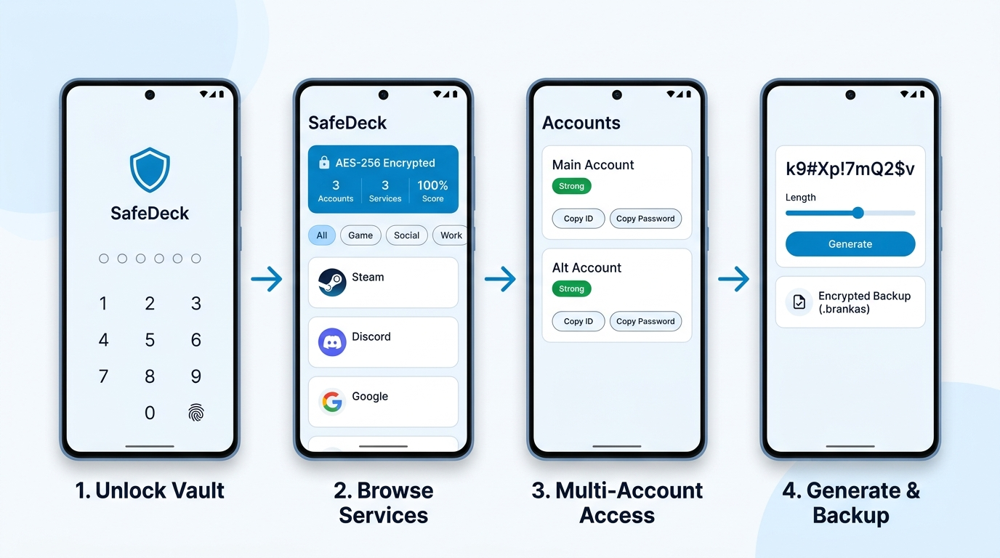

# SafeDeck

**SafeDeck** is an offline-first personal password and account vault for Android. All your credentials stay fully encrypted on your device—no cloud servers, no accounts required, and no tracking.

## Download

- **Android (APK):** [Download SafeDeck v1.0.0](https://github.com/nluthfi/SafeDeck/releases/tag/v1.0.0)

> **Installation:** Download `SafeDeck-v1.0.0.apk` from the Releases page, open it on your Android device, and allow installing from unknown sources if prompted.

---

## How It Works

1. **Unlock Vault** — Enter your 6-digit Master PIN or unlock instantly with biometrics.
2. **Browse Services** — Check your security overview, filter by category, or search across saved services.
3. **Multi-Account Access** — Open any service to view all linked accounts and copy IDs or passwords in one tap.
4. **Generate & Backup** — Create strong random passwords and export encrypted `.brankas` backups anytime.

---

## Features

- **Service -> Multi-Account Organization**: Group multiple accounts (e.g. main, alt, work, or bot) under a single service such as Steam, Discord, Google, and more.
- **Customizable Service Cards**: Set categories, accent colors, auto-detected brand icons or custom photos, and reorder services with drag-and-drop.
- **Instant Search**: Quickly search across services, account labels, usernames, and emails.
- **Strong Password Generator**: Generate cryptographically random passwords (8–64 characters) with uppercase, lowercase, numbers, symbols, and an option to avoid ambiguous characters (`i, l, 1, 0, O`).
- **Password Strength & Safety Score**: View per-account password strength indicators alongside an overall vault safety score.
- **Complete Account Details**: Store usernames/IDs, emails, passwords, 2FA recovery codes, and notes with one-tap copy actions.
- **Multi-Language Support**: Available in **English** and **Bahasa Indonesia** (follows your device language by default and can be switched anytime in Settings).
- **Encrypted Backups**: Export and restore your vault as password-protected `.brankas` backup files.

---

## Security

- **100% Offline & Local**: No data ever leaves your device.
- **AES-256 Encrypted Database (SQLCipher)**: The local database is fully encrypted with a device-generated 256-bit key stored in Android Keystore.
- **6-Digit Master PIN & Biometrics**: Your PIN is hashed locally with PBKDF2-HMAC-SHA256 (100,000 iterations) and protected by a 30-second lockout after 5 failed attempts.
- **Auto-Lock & Clipboard Auto-Clear**: Automatically locks the vault when backgrounded and clears copied passwords from the clipboard (default: 30 seconds).
- **Screen Protection (`FLAG_SECURE`)**: Blocks screenshots, screen recording, and app-switcher previews.
- **AES-256-GCM Backups**: Exported `.brankas` files use authenticated encryption derived from your backup password.
